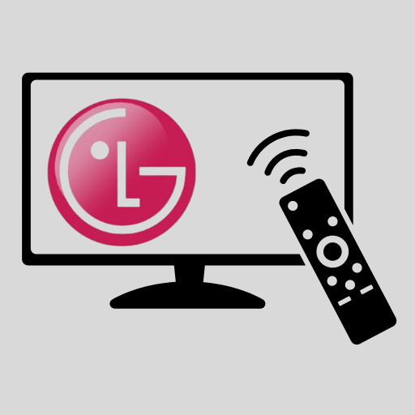
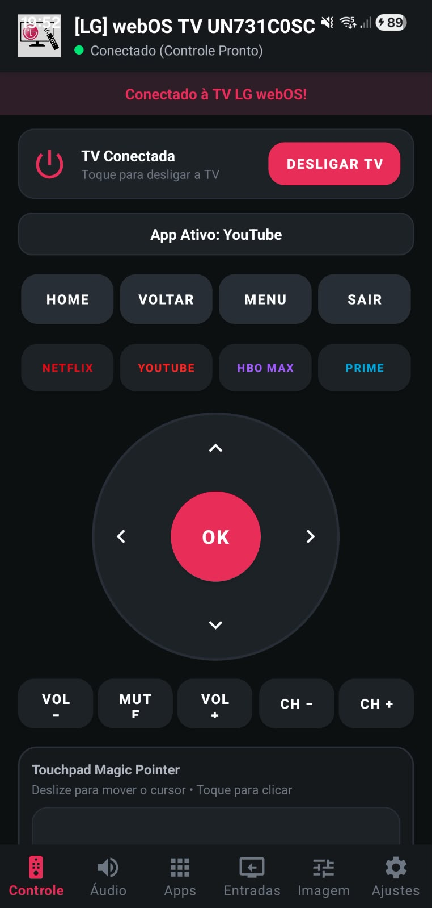
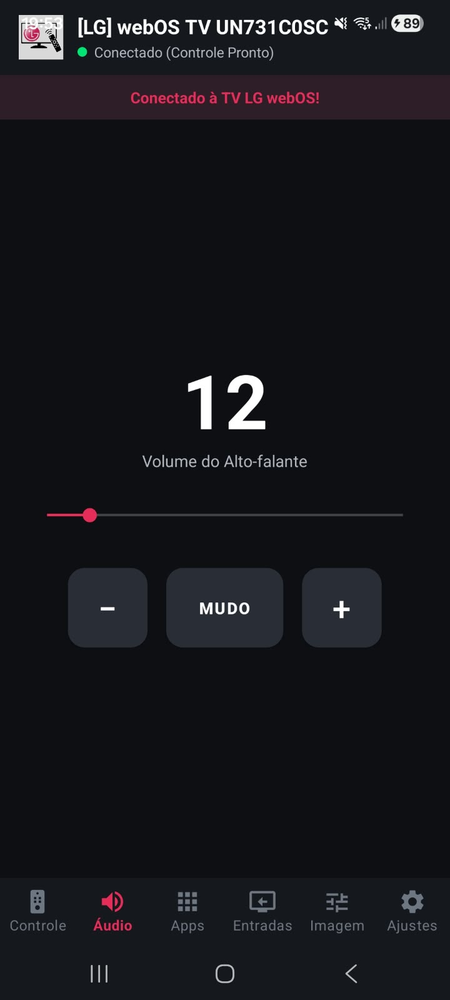
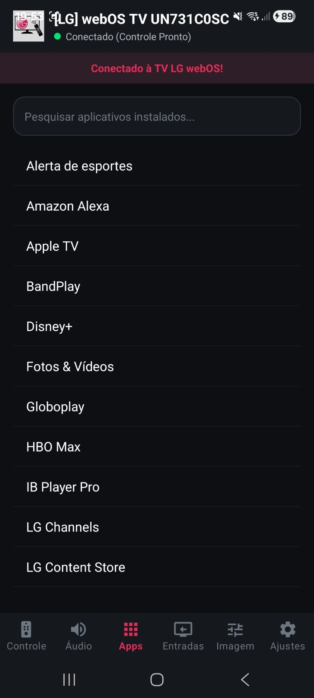
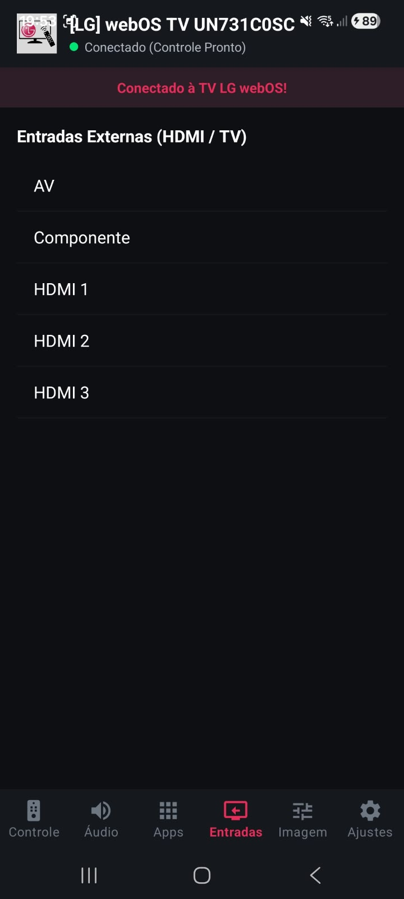
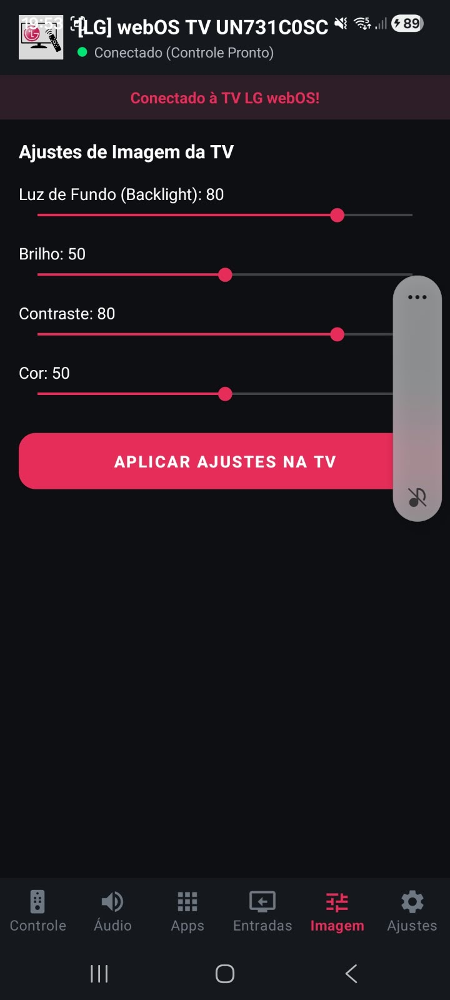
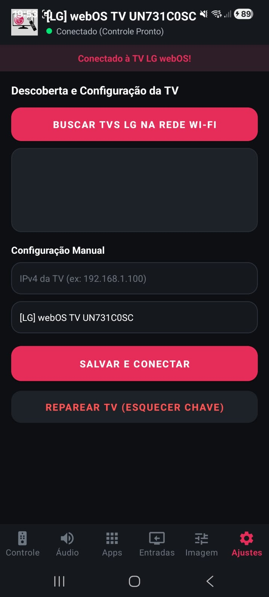

# LG webOS Remote 📺📱

  

  <b>A modern, fast, and intuitive remote controller for LG webOS Smart TVs on Android.</b>

  <a href="README.md">🇧🇷 Português</a> •
  <a href="README_EN.md">🇺🇸 English</a> •
  <a href="README_ES.md">🇪🇸 Español</a>

---

## 🌟 Overview

**LG webOS Remote** is an Android application built with **.NET 10** designed to give you seamless, full control of your LG webOS Smart TV directly from your smartphone over your local Wi-Fi network.

It works in any home and on any standard Wi-Fi router: all you need is your Smart TV and Android phone connected to the same local network. No external cloud servers or accounts required—100% private and local.

---

## 📸 App Screenshots

  <table>
    <tr>
      <td align="center" width="33%">
        <b>Remote Control</b> 
        
      </td>
      <td align="center" width="33%">
        <b>Audio</b> 
        
      </td>
      <td align="center" width="33%">
        <b>Applications</b> 
        
      </td>
    </tr>
    <tr>
      <td align="center" width="33%">
        <b>Inputs (HDMI)</b> 
        
      </td>
      <td align="center" width="33%">
        <b>Picture Settings</b> 
        
      </td>
      <td align="center" width="33%">
        <b>Settings &amp; Connection</b> 
        
      </td>
    </tr>
  </table>

---

## ✨ Features

- 🕹️ **Full Remote Control**: Circular D-Pad, Center OK button, Home, Back, Menu, Exit, Volume (+/-), Channels (+/-), and Mute.
- 🚀 **Quick Streaming Shortcuts**: One-tap access to **Netflix**, **YouTube**, **HBO Max**, and **Prime Video**.
- 🔌 **Power Management**: Turn off your TV directly from the app when connected, or tap to reconnect instantly.
- 🔊 **Fine Audio Control**: 0–100 volume slider, live level indicator, and toggleable Mute/Unmute.
- 📱 **Alphabetical Apps Catalog**: All TV apps listed from A to Z with real-time search filtering.
- 📺 **Input Switcher**: Easily switch between HDMI 1, HDMI 2, HDMI 3, AV, and Component inputs.
- 🎨 **Picture Calibration**: Adjust TV Backlight, Brightness, Contrast, and Color on the fly.
- 🔍 **Automatic Discovery**: Scans your local Wi-Fi network via SSDP to find LG TVs automatically.
- ✍️ **Manual Setup**: Manually specify the TV IPv4 address if your router blocks multicast traffic.
- 🌐 **Multi-Language Support**: Seamlessly toggle between **English**, **Portuguese**, and **Spanish** in the Settings tab.
- 🔒 **Secure & Persistent Connection**: Uses official LG webOS WebSocket protocol with local client key caching.

---

## 🚀 How to Connect to Your TV

### 1. Prerequisites
1. Ensure your **LG Smart TV** is turned on.
2. Ensure both the TV and your Android phone are connected to the **same Wi-Fi network**.

### 2. Pairing & Connecting
1. Open the **LG webOS Remote** app on your phone.
2. Navigate to the **Settings** tab (gear icon on the bottom navigation bar).
3. Tap **Search LG TVs on Wi-Fi**:
   - Discovered TVs will appear in the list. Tap your TV to connect.
   - *Manual Alternative*: If discovery does not find your TV, enter its IPv4 address in the **TV IPv4** field (e.g. `192.168.1.100`) and tap **Save and Connect**.
4. **Look at your TV screen**:
   - A pairing prompt will appear: *"LG webOS Remote requests connection"*.
   - Use your TV's physical remote to click **Allow** / **Yes**.
5. The app will display a confirmation popup: **"Successfully Connected! 🎉"**.
6. That's it! The pairing key is securely stored on your phone, and your remote is ready to use.

---

## 🌐 How to Change Language

1. Open the app and go to the **Settings** tab.
2. In the **App Language** section, tap your preferred language:
   - 🇧🇷 **Português**
   - 🇺🇸 **English**
   - 🇪🇸 **Español**
3. The interface immediately reloads in the chosen language and saves your preference.

---

## 📥 Installing (.APK)

1. Navigate to the [Releases](../../releases) section of this GitHub repository.
2. Download `LGwebOSRemote-Release.apk`.
3. Open the downloaded file on your Android device and allow installations from unknown sources if prompted.
4. Finish installation and enjoy!

---

## 🛠️ Tech Stack

- **C# / .NET 10 Android**
- **Material Components for Android** (BottomNavigationView, Toolbar, Cards)
- **WebSockets (`ClientWebSocket`)** for bi-directional communication with LG webOS
- **SSDP / UDP Sockets** for local network discovery
- **JSON System.Text.Json**

---

## 📄 License

Distributed under the MIT License. See `LICENSE` for more information.
